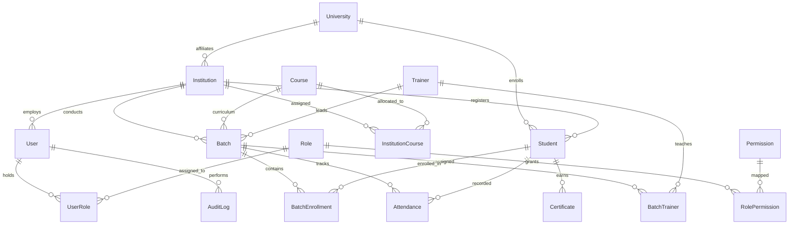

# AP Skill Development LMS Platform — Architecture & Deliverables

## 1. Design System (Primary Palette)
- **Primary Color**: Deep Forest Green (`#0F3D2E`)
- **Surface / Contrast Color**: Pure White (`#FFFFFF`)
- **Typography**: `Geist` (UI) & `Geist Mono` (IDs, codes, roll numbers)
- **Responsive Breakpoints**: Desktop (`1440px`), Tablet (`1024px`), Mobile (`375px+` with collapsible drawer sidebar & horizontally scrollable tables)

---

## 2. Complete UI/UX Sitemap

### Public & First-Login Flow
- `/` → `LoginView` (Username or Email sign-in, Forgot Password request)
- `/` (when `mustChangePassword === true`) → `ForcePasswordModal` ("Create New Password" with 5-point complexity gate)

### Super Admin Command Center (`STATEWIDE` / `DISTRICT` Scope)
- **Dashboard**: Statewide 360-Degree Overview (12 KPIs, 8 Dynamic Analytics Filters, District/University/Course/Certificate panels, Alerts & Exceptions), Global Search
- **Organization**: Universities Master, Institutions Master (800-scale, `+ Create College Admin` workflow)
- **Users & Access**: College Admins & Credential Provisioning, Role Hierarchy & RBAC Matrix (`roles`, `permissions`, `role_permissions`, `user_roles`)
- **Students**: Statewide Student Database (bulk operations, 360° Student Profile modal), Import Students (CSV template + validation)
- **Courses & Training**: Course Catalog, Trainers Master, Batches & Trainer Assignments (7-tab Batch Details modal)
- **Reports**: Centralized Report Engine (15 report types, date presets/custom range, CSV / Excel / PDF export)
- **System**: Notification Center, Audit Logs & System Settings, Profile & Security

### College Admin Workspace (`INSTITUTION` Scope — Strictly Isolated)
- **Dashboard**: Institution Overview (8 KPIs, Quick Actions, Deep Forest Green charts, Recent Activities)
- **Students**: Institution Student List (Search, Pagination, Register, Deactivate/Restore, 360° Student Profile), Import Students
- **Batches & Enrollment**: Batch List, Create Batch, Enroll Student, Training Progress, 7-tab Batch Details
- **Courses & Trainers**: Approved/Assigned Courses, Assigned Trainers
- **Attendance**: Daily Batch Attendance (`PRESENT`, `ABSENT`, `LATE`, `EXCUSED`) + Cumulative Attendance %
- **Reports**: Scoped Institution Reports (CSV / Excel / PDF)
- **System**: Notification Center, My Profile & Change Password

---

## 3. Page-by-Page Wireframe Structure
Every workspace screen follows a consistent 4-zone enterprise layout:
1. **Left Sidebar (`256px`, `#0F3D2E`)**: Brand emblem, tenant/scope badge, grouped navigation items filtered dynamically by `permissions`.
2. **Top Header (`56px`, `#FFFFFF`)**: Mobile drawer toggle, Breadcrumb (`AP Skill Dev LMS / Group / Page`), Notification bell badge, Role/User pill.
3. **Toolbar**: Page Title, Subtitle, Action buttons (`+ Add`, `Export`, `Bulk Actions`), Search & Filter bar.
4. **Content Area**: KPI Grid → Charts / Alerts → Paginated Data Table (`overflow-x-auto`) → Detail Modals (`StudentProfileModal`, `BatchDetailsModal`, `Create College Admin`).

---

## 4. Database ERD (Mermaid)

---

## 5. Role-Permission Matrix (`roles`, `permissions`, `role_permissions`, `user_roles`)

| Role | Scope | Level | Key Permissions |
| :--- | :--- | :---: | :--- |
| `SUPER_ADMIN` | `STATEWIDE` | 1 | All 22 permissions (Universities, Institutions, Admins, Courses, Trainers, Batches, Students, Sensitive IDs, Reports, RBAC, Governance, Audit) |
| `STATE_COORDINATOR` | `STATEWIDE` | 2 | Statewide dashboard, global search, read institutions/courses/trainers/batches/students/attendance, read & export reports |
| `AUDITOR` | `STATEWIDE` | 2 | Statewide dashboard, read institutions/batches/students/attendance, audit logs, read & export reports |
| `REPORTING_OFFICER` | `STATEWIDE` | 2 | Statewide dashboard, read institutions/batches/students/attendance, read & export reports |
| `DISTRICT_COORDINATOR` | `DISTRICT` | 3 | Statewide/district dashboard, read institutions/courses/trainers/batches/students/attendance/reports |
| `COLLEGE_ADMIN` | `INSTITUTION` | 4 | Institution dashboard, manage own students/batches, mark attendance, read assigned courses/trainers, export own reports |
| `INSTITUTION_MANAGER` | `INSTITUTION` | 4 | Institution dashboard, manage own batches, mark attendance, read own students/reports |
| `TRAINER` | `BATCH` | 5 | Institution/batch view, read courses/batches/students, mark & read attendance |

---

## 6. Authentication & Tenant Isolation Flow
1. User submits `identifier` (Admin Username e.g. `ADM-AP-VSP-001` or Official Email) + `password` to `POST /api/auth/login`.
2. `checkRateLimit()` enforces sliding-window brute-force protection (`429` after 15 attempts / 5 min).
3. `bcryptjs` verifies `passwordHash`; inactive users or deactivated institutions are rejected.
4. Signed HS256 JWT is stored in `httpOnly` cookie `ap_lms_session`.
5. If `mustChangePassword === true`, `requireSession()` blocks all workspace APIs (`403`) until `POST /api/auth/change-password` validates complexity (8+ chars, upper, lower, number, symbol) and sets `passwordChangedAt`.
6. Every API checks `requirePermission()` / `requireAnyPermission()` resolved from `user_roles -> role_permissions -> permissions`, and `assertInstitutionScope(session, targetInstitutionId)` enforces `WHERE institutionId = session.institutionId` for non-statewide roles.

---

## 7. Unique ID Generation Logic
- **Student LMS ID (Immutable)**: Configurable via `SystemConfig` (`STUDENT_ID_PATTERN`), default `AP-{UNIVERSITY_CODE}-{INSTITUTION_CODE}-{YEAR}-{SEQUENCE}` (e.g., `AP-SVU-APTPT003-2026-000010`). Stored alongside separate `universityRollNo`.
- **Batch Code**: `BAT-{UNIVERSITY_CODE}-{INSTITUTION_CODE}-{YEAR}-{SEQUENCE}` (e.g., `BAT-SVU-TPT003-2026-00005`).
- **College Admin Username**: `ADM-{INSTITUTION_CODE}` (e.g., `ADM-AP-VSP-001`).

---

## 8. Folder Structure

### Frontend (`src/components/` & `src/app/`)
- `src/app/page.tsx` — Session gate, first-login password reset gate, scope-based workspace router
- `src/components/LoginView.tsx` — Sign-in & Forgot Password
- `src/components/ForcePasswordModal.tsx` — Mandatory temporary password change
- `src/components/SuperAdminWorkspace.tsx` — Statewide command center
- `src/components/CollegeAdminWorkspace.tsx` — Institution-isolated workspace
- `src/components/RbacManagementPanel.tsx` — Role hierarchy, dynamic role creation, permission matrix, `user_roles`
- `src/components/StudentProfileModal.tsx` — 360° student profile & activity timeline
- `src/components/BatchDetailsModal.tsx` — 7-tab batch operations modal
- `src/components/ImportStudentsPanel.tsx` — CSV template, dry-run validator & commit
- `src/components/NotificationCenterPanel.tsx` — Notification center
- `src/components/ProfilePanel.tsx` — Profile & password management

### Backend (`src/lib/` & `src/app/api/`)
- `src/lib/prisma.ts` — Singleton Prisma Client
- `src/lib/auth.ts` — JWT session, RBAC permission resolution, tenant isolation, `logAudit()`
- `src/lib/workflows.ts` — Controlled state transitions (`STUDENT_TRANSITIONS`, `BATCH_TRANSITIONS`, `INSTITUTION_TRANSITIONS`)
- `src/lib/apiError.ts` — Centralized error mapping (`401`, `403`, `404`, `409`, `422`, `429`, `500`)
- `src/lib/rateLimit.ts` — Sliding-window login rate limiter

---

## 9. API Endpoint Inventory
- **Auth & Profile**: `POST /api/auth/login`, `POST /api/auth/logout`, `GET /api/auth/me`, `POST /api/auth/change-password`, `POST /api/auth/forgot-password`, `PATCH /api/profile`
- **Dashboard & Search**: `GET /api/dashboard`, `GET /api/search`
- **Masters**: `GET/POST/PATCH /api/universities`, `GET/POST/PATCH /api/institutions`, `GET/POST/PATCH /api/admins`, `GET/POST/PATCH /api/courses`, `GET/POST/PATCH /api/trainers`
- **Operations**: `GET/POST/PATCH /api/students`, `GET /api/students/[id]`, `GET/POST /api/students/import`, `GET/POST/PATCH /api/batches`, `GET /api/batches/[id]`, `GET/POST /api/attendance`, `POST /api/bulk`
- **Reporting & Governance**: `GET /api/reports`, `GET/PATCH /api/governance`, `GET/POST/PATCH /api/rbac`, `GET/PATCH /api/notifications`, `GET/POST /api/files`

---

## 10. Production Deployment & Scalability Strategy
- **Database**: Switch `datasource db { provider = "postgresql" }` in `prisma/schema.prisma` with connection pooling (PgBouncer / RDS Proxy) and read replicas for `/api/reports` & `/api/dashboard`.
- **Caching & Queues**: Introduce Redis for session/permission caching and BullMQ background workers for large CSV imports and scheduled PDF/Excel report generation.
- **Object Storage**: Back `FileAsset` `storageKey` with S3 / GCS private buckets using short-lived pre-signed URLs.
